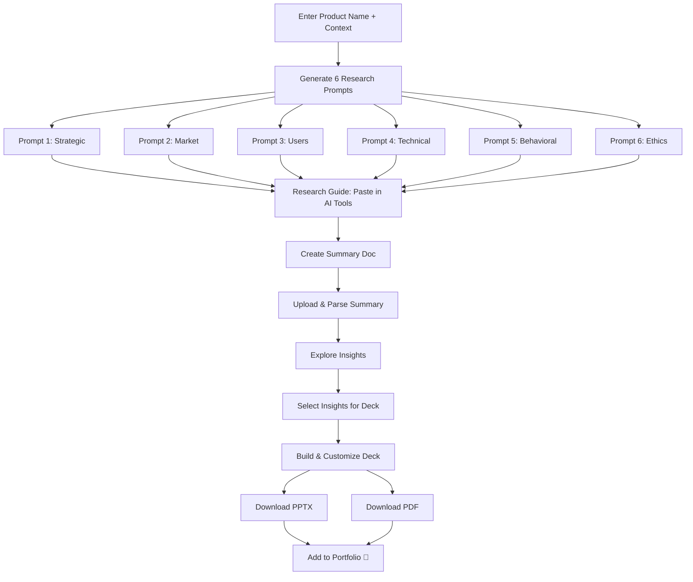

# 🔬 Product Discovery & Teardown — Project Plan (v3)

## Overview

A **100% client-side React web application** that helps Product Managers perform **structured deep research** on any app/product, generate **targeted AI prompts** across 6 research pillars, and build a **polished teardown presentation** for their portfolio — all without any backend, API keys, or LLM integration.

### Core Workflow
```
Input Product Name → Generate 6 Research Prompts → Copy & Research in AI Tools
→ Create Summary Doc (guided) → Upload & Parse Summary → Explore Insights
→ Build Your Deck → Download PPTX + PDF → Add to Portfolio
```

### Legal & Ethical Guardrails
- ❌ **No intellectual property** — No proprietary code, internal docs, or trade secrets
- ❌ **No PII** — No personal identifiable information of any individual
- ❌ **No confidential data** — No leaked financials, internal memos, or NDA-covered material
- ✅ **Public information only** — All research based on publicly available sources
- ✅ **Public images only** — Screenshots from app stores, marketing sites, and public demos
- ✅ **Attribution** — Sources cited where applicable

### Security Decision: No BYOK
This project intentionally avoids Bring Your Own Key (BYOK) LLM integration due to browser-side security risks (XSS key exposure, supply-chain attacks, network interception). Users run prompts in their own AI tools externally.

---

## 🗂️ Research Pillars & Prompt Strategy

All research organized into **6 Pillars**, each generating its own deep-search prompt:

### Pillar 1: Strategic & Business Context
> **Prompt Name**: `Strategic Deep Dive`

| Research Lens | What We Uncover |
|---|---|
| Mission & Vision | Company's north star, founding thesis |
| Company Verticals | Which lines of business exist, where this app sits |
| Revenue Model | How this app generates money (subscriptions, ads, transactions, etc.) |
| Ecosystem | Partner integrations, platform dependencies, API economy |
| Regulatory Landscape | Compliance requirements, data privacy, industry regulations |
| Business ↔ Mission Conflict | Tension between monetization and user value |
| Unit Economics & LTV/CAC | CAC, LTV ratio, payback period, expansion revenue, NRR |
| Privacy & Data Strategy | Data minimization, consent architecture, privacy as competitive advantage |
| Product Lifecycle Stage | Where on the Ideation → Growth → Maturity → Decline curve |

### Pillar 2: Market, Competition & Go-To-Market
> **Prompt Name**: `Market & Competitive Intelligence`

| Research Lens | What We Uncover |
|---|---|
| Competitive Dynamics | Direct/indirect competitors, positioning, moats |
| Go-to-Market Strategy | Distribution channels, growth loops, acquisition |
| Market Entry | When/how they entered, beachhead market |
| Pricing Strategy | Tiers, freemium, enterprise pricing, price anchoring |
| Flywheel & Network Effects | Self-reinforcing growth loops, network effects |
| Growth Loops | Viral loops, content-led loops, paid loops (Reforge framework) |
| Switching Costs & Lock-in | Data, financial, social/relational, customization lock-in mechanics |

### Pillar 3: Users, Outcomes & Product Craft
> **Prompt Name**: `User & Product Deep Dive`

| Research Lens | What We Uncover |
|---|---|
| User Segments | Who uses this, personas, demographics |
| Actors & Roles | Different user types and their permissions/workflows |
| Pain Points | Jobs-to-be-done, frustrations addressed |
| Business → Product Outcome Mapping | How business KPIs translate to product metrics |
| Prioritized Feature Set | Core vs differentiating features |
| Key Metrics & Guardrails | North star metric, input metrics, guardrail metrics |
| Aha Moment | The moment users realize product value |
| User Life Fit | How the app fits into daily routines |
| Activation & Time-to-Value (TTV) | Steps from download to "Aha!" moment, friction audit |
| Retention Curves & Cohort Analysis | D1/D7/D30 retention, cohort flattening, churn diagnostics |
| User Journey Mapping (Multi-layer) | Stages × actions × touchpoints × cognitive states × friction |
| Trade-off Analysis & Product Debt | MVP compromises, visible tech debt, prioritization philosophy |

### Pillar 4: Technical Architecture & Design
> **Prompt Name**: `Architecture & Design Teardown`

| Research Lens | What We Uncover |
|---|---|
| System Architecture | High-level tech stack, infrastructure |
| System Design | Data flow, API design, scalability patterns |
| Measurement Infrastructure | How they track and instrument |
| Failure Modes | What can go wrong, resilience patterns |
| Design System & UX Patterns | Visual language, interaction patterns, accessibility |
| Information Architecture | Navigation, content hierarchy |
| Platform Thinking & API Strategy | Core platform vs. feature bloat, API-as-product, extensibility |
| Experimentation & A/B Testing Culture | Feature flags, progressive rollouts, data-driven iteration |
| AI/ML Integration Sophistication | Genuine AI value vs. AI-washing, personalization depth |
| Internationalization & Localization | Multi-language, cultural adaptation, RTL, localized payments |
| Accessibility (A11y) Audit | WCAG compliance, universal design, curb-cut effect |

### Pillar 5: Behavioral Psychology & Engagement
> **Prompt Name**: `Behavioral & Engagement Deep Dive`

| Research Lens | What We Uncover |
|---|---|
| Hook Model & Habit Architecture | Trigger → Action → Variable Reward → Investment (Nir Eyal) |
| Cognitive Biases in Product Design | Endowment effect, defaults, loss aversion, anchoring, social proof |
| Onboarding Psychology | Fogg Behavior Model (B=MAT), progressive disclosure, motivation design |
| Engagement Depth & Frequency | DAU/MAU stickiness, habit loops, core action frequency |

### Pillar 6: Trust, Safety & Ethics
> **Prompt Name**: `Trust, Safety & Ethics Audit`

| Research Lens | What We Uncover |
|---|---|
| Trust & Safety by Design | Abuse prevention, content moderation, safety filters, reporting |
| Dark Patterns & Ethical Design | Forced continuity, hidden fees, disguised ads, digital well-being |
| Algorithmic Fairness | ML model bias auditing, equitable outcomes |
| Data Governance | Collection scope, retention policies, transparency |

---

## 🛠️ Skills Architecture

### Prompt Generation Skills (1 per pillar)

| # | Skill Name | Pillar | Key Frameworks Used |
|---|-----------|--------|-------------------|
| 1 | `product-strategic-research` | Strategic & Business | Business Model Canvas, Porter's Value Chain, Lifecycle Analysis |
| 2 | `product-market-research` | Market & Competition | Porter's Five Forces, Reforge Growth Loops, Competitive Moats |
| 3 | `product-user-research` | Users & Product Craft | JTBD, HEART/AARRR Metrics, Outcome Mapping, Retention Analysis |
| 4 | `product-technical-research` | Architecture & Design | System Design, C4 Model, API Maturity, A11y Audit |
| 5 | `product-behavioral-research` | Behavioral Psychology | Hook Model, Fogg B=MAT, Cognitive Bias Codex |
| 6 | `product-ethics-research` | Trust, Safety & Ethics | Ethical Design Checklist, Privacy by Design, Dark Pattern Taxonomy |

### Teardown Production Skills

| # | Skill Name | Purpose |
|---|-----------|---------| 
| 7 | `teardown-design-theme` | Analyze the app's design language, extract brand colors/fonts, apply to teardown deck |
| 8 | `teardown-visual-assets` | Guide downloading public screenshots/images, organize into slide-ready library |

---

## 🌐 Web Application Architecture

### Revised User Flow (6 Stages)

```
Stage 1: INPUT
┌─────────────────────────────────────────┐
│  Enter Product/App Name                 │
│  Select category, platform, biz model   │
│  [Generate Research Prompts →]          │
└──────────────────┬──────────────────────┘
                   │
Stage 2: PROMPT GENERATION
┌──────────────────▼──────────────────────┐
│  6 Research Prompt Cards                │
│  Each with [Copy 📋] [Preview] [Edit]   │
│  ┌─────┐ ┌─────┐ ┌─────┐              │
│  │ P1  │ │ P2  │ │ P3  │              │
│  └─────┘ └─────┘ └─────┘              │
│  ┌─────┐ ┌─────┐ ┌─────┐              │
│  │ P4  │ │ P5  │ │ P6  │              │
│  └─────┘ └─────┘ └─────┘              │
│  [Copy All] [Download .md]              │
└──────────────────┬──────────────────────┘
                   │
Stage 3: RESEARCH GUIDE
┌──────────────────▼──────────────────────┐
│  How to Use Your Prompts                │
│  ┌────────┐ ┌────────┐ ┌────────┐      │
│  │ChatGPT │ │ Gemini │ │ Claude │      │
│  └────────┘ └────────┘ └────────┘      │
│  ┌────────┐                             │
│  │Perplxty│  Pro: Use NotebookLM to     │
│  └────────┘  synthesize all 6 outputs   │
│                                         │
│  [📥 Download Summary Template]          │
│  [Continue to Upload →]                 │
└──────────────────┬──────────────────────┘
                   │
Stage 4: UPLOAD & PARSE
┌──────────────────▼──────────────────────┐
│  ┌──────────────────────────────────┐   │
│  │                                  │   │
│  │   Drag & drop your summary      │   │
│  │   document here (.md or .txt)    │   │
│  │                                  │   │
│  └──────────────────────────────────┘   │
│  Parse progress → pillar mapping →      │
│  confidence scoring                     │
│  [Explore Insights →]                   │
└──────────────────┬──────────────────────┘
                   │
Stage 5: INSIGHT EXPLORER
┌──────────────────▼──────────────────────┐
│  ┌─────────┬───────────────────────┐    │
│  │ PILLARS │  Insight Cards Grid   │    │
│  │ ● Strat │  ┌─────┐ ┌─────┐     │    │
│  │ ○ Markt │  │Card │ │Card │     │    │
│  │ ○ Users │  └─────┘ └─────┘     │    │
│  │ ○ Tech  │  ┌─────┐ ┌─────┐     │    │
│  │ ○ Behav │  │Card │ │Card │     │    │
│  │ ○ Ethcs │  └─────┘ └─────┘     │    │
│  │─────────│                       │    │
│  │ 47 total│  Filter | Search     │    │
│  │ 12 sel. │  [+ Add to Deck]     │    │
│  └─────────┴───────────────────────┘    │
│  [Build Your Deck →]                    │
└──────────────────┬──────────────────────┘
                   │
Stage 6: BUILD YOUR DECK
┌──────────────────▼──────────────────────┐
│  ┌────────────┬────────────────────┐    │
│  │ Slide List │  Slide Preview     │    │
│  │ (drag to   │  ┌──────────────┐  │    │
│  │  reorder)  │  │              │  │    │
│  │            │  │  Live WYSIWYG│  │    │
│  │ 1. Title   │  │  Preview     │  │    │
│  │ 2. Summary │  │              │  │    │
│  │ 3. Market  │  └──────────────┘  │    │
│  │ ...        │                    │    │
│  └────────────┴────────────────────┘    │
│  [Download PPTX] [Download PDF]         │
└─────────────────────────────────────────┘
```

### Tech Stack
- **Framework**: React 19 + TypeScript + Vite
- **Styling**: Tailwind CSS v4 + shadcn/ui
- **State**: React Context + useReducer
- **Routing**: React Router v7
- **Animations**: Framer Motion
- **Markdown Parsing**: unified + remark + rehype
- **File Upload**: react-dropzone
- **Drag & Drop**: @dnd-kit/core
- **PPT Generation**: PptxGenJS (client-side PPTX synthesis)
- **PDF Export**: jsPDF + html2canvas (client-side slide-to-PDF rendering)
- **Deployment**: Vercel (primary), GitHub Pages (fallback)

---

## 📊 Teardown Deck Framework (10 Slides)

Based on McKinsey Pyramid Principle + PM Portfolio best practices.

### Design Rules
- **Max 10 slides** — Forces signal-over-noise discipline
- **Min 14pt text** — Ensures readability in all formats
- **Action Titles** — Every slide title states an insight, not just a topic
- **Public images only** — App store screenshots, marketing material, public demos
- **No IP/PII** — Zero confidential, proprietary, or personal data
- **MECE structure** — Categories don't overlap, leave no blind spots
- **Visual-first** — Annotated screenshots, diagrams, matrices over text walls

### Slide Structure

| Slide | Title Pattern | Content |
|-------|--------------|---------| 
| **1** | Title & Thesis | Product name, one-line thesis, your name, date |
| **2** | Executive Summary | Core verdict, 3 key findings, strategic implication |
| **3** | Business Model & Market | Revenue model, TAM/SAM, competitive 2×2 matrix |
| **4** | User Personas & Pain Points | Primary/secondary personas, JTBD statements, core pain points |
| **5** | Onboarding & Activation | Step-by-step flow, TTV analysis, friction audit with annotated screenshots |
| **6** | Core Product & Features | Feature architecture, information architecture, annotated UI |
| **7** | Growth & Retention Engine | Growth loops diagram, retention mechanics, Hook Model analysis |
| **8** | Behavioral & Trust Analysis | Cognitive biases used, ethical design audit, trust signals |
| **9** | Critique & Opportunities | 2-3 gaps with Impact vs Effort matrix, proposed improvements |
| **10** | Strategic Recommendations | North star metric, guardrail metrics, forward-looking strategy |

---

## 📋 Implementation Phases

### Phase 0: Scaffolding
- [ ] Vite + React + TypeScript + Tailwind v4 project setup
- [ ] shadcn/ui initialization
- [ ] React Router setup with 6 stage routes
- [ ] App shell with header, progress bar, page transitions

### Phase 1: Product Input (Stage 1)
- [ ] Product name and company input form
- [ ] Category, platform, business model selectors
- [ ] Validation and navigation to Stage 2

### Phase 2: Skills Data Pipeline
- [ ] Vite plugin or build script to parse SKILL.md → JSON
- [ ] TypeScript types for skill data
- [ ] Validation of all 6 skills loaded

### Phase 3: Prompt Composition Engine
- [ ] Template interpolation with product context
- [ ] Lens question injection into prompt templates
- [ ] Category/platform-aware filtering
- [ ] Cross-pillar deduplication

### Phase 4: Prompt Generation UI (Stage 2)
- [ ] 6-card prompt grid with copy/preview/edit
- [ ] Full prompt preview modal
- [ ] Batch actions (copy all, download)
- [ ] Transition to Stage 3

### Phase 5: Research Guide (Stage 3)
- [ ] AI tool recommendation cards
- [ ] Summary document template download
- [ ] NotebookLM synthesis workflow guide
- [ ] Example summary (collapsible)

### Phase 6: Upload & Parse (Stage 4)
- [ ] Drag-and-drop file upload (react-dropzone)
- [ ] Deterministic Markdown parser (remark AST)
- [ ] Fuzzy header-to-pillar mapping
- [ ] Insight extraction and confidence scoring

### Phase 7: Insight Explorer (Stage 5)
- [ ] Pillar sidebar navigation
- [ ] Masonry insight card grid
- [ ] Card types (finding, metric, gap, recommendation, framework)
- [ ] Filtering, search, selection for deck

### Phase 8: Deck Builder (Stage 6)
- [ ] Drag-and-drop slide reordering
- [ ] Live slide preview
- [ ] Theme selection
- [ ] PPTX generation with PptxGenJS
- [ ] PDF export

### Phase 9: Polish & Deploy
- [ ] Performance optimization
- [ ] Accessibility audit
- [ ] Vercel deployment
- [ ] README and documentation

---

## 🎯 End-to-End Workflow


