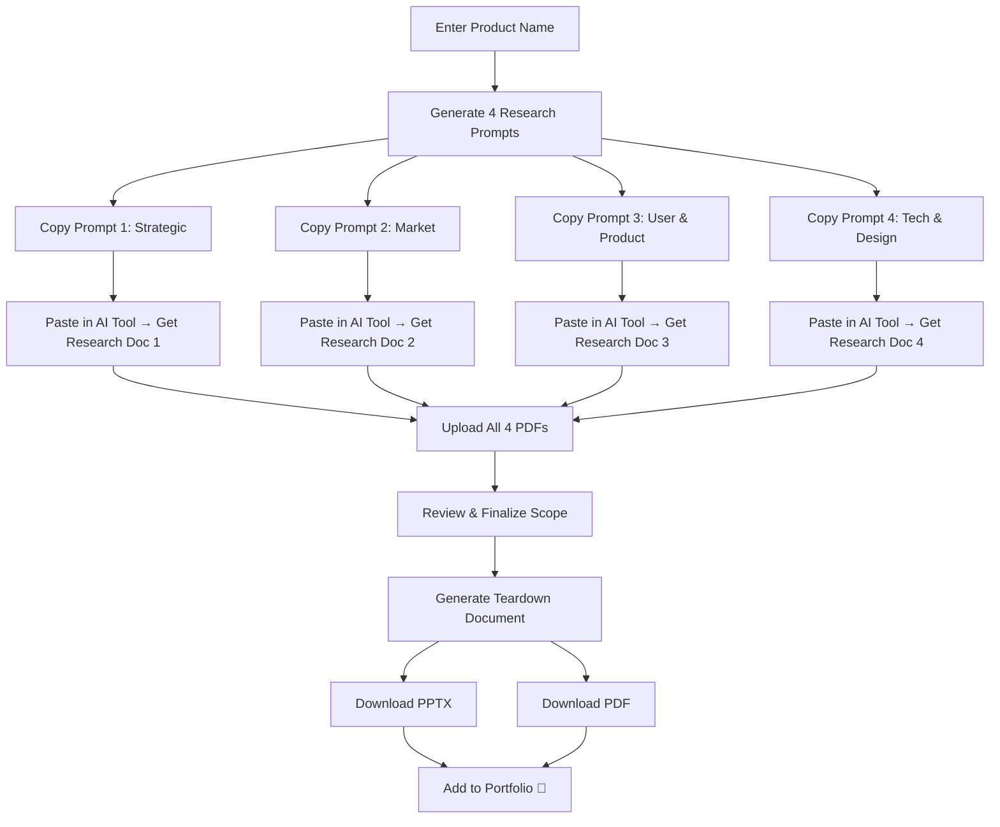

# 🔬 Product Discovery & Teardown — Project Plan

## Overview

A web application + skill system that helps a Product Manager perform **structured deep research** on any app/product, generate **targeted AI prompts** across multiple research lenses, and ultimately produce a **polished teardown document** for their portfolio.

---

## 🗂️ Research Buckets & Prompt Strategy

Your ideas organized into **4 Research Pillars**, each generating its own deep-search prompt and research document:

### Pillar 1: Strategic & Business Context
> **Prompt Name**: `Strategic Deep Dive`

| Research Lens | What We Uncover |
|---|---|
| Mission & Vision | Company's north star, founding thesis |
| Company Verticals | Which lines of business exist, where this app sits |
| Revenue Model | How this app generates money (subscriptions, ads, transactions, etc.) |
| Ecosystem | Partner integrations, platform dependencies, API economy |
| Regulatory Landscape | Compliance requirements, data privacy, industry regulations |
| Business ↔ Mission Conflict | Tension between monetization and user value |

### Pillar 2: Market, Competition & Go-To-Market
> **Prompt Name**: `Market & Competitive Intelligence`

| Research Lens | What We Uncover |
|---|---|
| Competitive Dynamics | Direct/indirect competitors, positioning, moats |
| Go-to-Market Strategy | Distribution channels, growth loops, acquisition |
| Market Entry | When/how they entered, beachhead market |
| Pricing Strategy | Tiers, freemium, enterprise pricing, price anchoring |
| Flywheel & Network Effects | Self-reinforcing growth loops, network effects |

### Pillar 3: Users, Outcomes & Product Craft
> **Prompt Name**: `User & Product Deep Dive`

| Research Lens | What We Uncover |
|---|---|
| User Segments | Who uses this, personas, demographics |
| Actors & Roles | Different user types and their permissions/workflows |
| Pain Points | Jobs-to-be-done, frustrations addressed |
| Business → Product Outcome Mapping | How business KPIs translate to product metrics |
| Prioritized Feature Set | Core vs differentiating features |
| Key Metrics & Guardrails | North star metric, input metrics, guardrail metrics |
| Aha Moment | The moment users realize product value |
| User Life Fit | How the app fits into daily routines |

### Pillar 4: Technical Architecture & Design
> **Prompt Name**: `Architecture & Design Teardown`

| Research Lens | What We Uncover |
|---|---|
| System Architecture | High-level tech stack, infrastructure |
| System Design | Data flow, API design, scalability patterns |
| Measurement Infrastructure | How they track and instrument |
| Failure Modes | What can go wrong, resilience patterns |
| Design System & UX Patterns | Visual language, interaction patterns, accessibility |
| Information Architecture | Navigation, content hierarchy |

---

## 🛠️ Skills Architecture

### Skill 1: `product-strategic-research`
- **Purpose**: Generate Pillar 1 prompt (Strategic & Business Context)
- **Contains**: Frameworks for mission analysis, revenue model identification, ecosystem mapping
- **Output**: A rich, structured prompt for deep AI research

### Skill 2: `product-market-research`
- **Purpose**: Generate Pillar 2 prompt (Market & Competitive Intelligence)
- **Contains**: Porter's Five Forces lens, GTM frameworks, pricing strategy analysis templates
- **Output**: A structured prompt focused on competitive and market dynamics

### Skill 3: `product-user-research`
- **Purpose**: Generate Pillar 3 prompt (Users, Outcomes & Product Craft)
- **Contains**: JTBD framework, outcome mapping, metrics hierarchy (HEART, AARRR)
- **Output**: A prompt that surfaces user insights, feature strategy, and measurement

### Skill 4: `product-technical-research`
- **Purpose**: Generate Pillar 4 prompt (Architecture & Design)
- **Contains**: System design evaluation checklist, failure mode analysis, design heuristics
- **Output**: A prompt for technical architecture and design teardown

### Skill 5: `teardown-design-theme`
- **Purpose**: Analyze the researched app's design language and apply it to the teardown document
- **Contains**: Design token extraction guide, color/typography analysis, brand consistency checklist
- **Output**: Theme configuration (colors, fonts, layout style) for the teardown PPT

### Skill 6: `teardown-visual-assets`
- **Purpose**: Guide downloading and organizing screenshots/images of the app
- **Contains**: Screenshot checklist (onboarding, core flows, edge cases), image organization schema
- **Output**: Curated image library for the teardown document

---

## 🌐 Web Application Architecture

### Pages / Views

```
┌─────────────────────────────────────────────────┐
│                 Landing Page                     │
│  "Product Discovery & Teardown Engine"           │
│  [Enter App/Product Name] [Start Research →]     │
└────────────────────┬────────────────────────────┘
                     │
┌────────────────────▼────────────────────────────┐
│              Research Dashboard                   │
│                                                   │
│  ┌──────────┐ ┌──────────┐ ┌──────────┐ ┌──────┐│
│  │Strategic  │ │Market &  │ │User &    │ │Tech &││
│  │Deep Dive │ │Compete   │ │Product   │ │Design││
│  │          │ │          │ │          │ │      ││
│  │[Generate]│ │[Generate]│ │[Generate]│ │[Gen] ││
│  │[Copy] 📋 │ │[Copy] 📋 │ │[Copy] 📋 │ │[Copy]││
│  └──────────┘ └──────────┘ └──────────┘ └──────┘│
│                                                   │
│  ── Upload Research Documents ──                  │
│  [Upload PDF 1] [Upload PDF 2] [Upload PDF 3]    │
│  [Upload PDF 4]                                   │
│                                                   │
│  [Generate Teardown →]                            │
└────────────────────┬────────────────────────────┘
                     │
┌────────────────────▼────────────────────────────┐
│           Teardown Builder                        │
│                                                   │
│  Preview teardown slides                          │
│  Edit/reorder sections                            │
│  [Download as PPTX]  [Download as PDF]            │
└─────────────────────────────────────────────────┘
```

### Tech Stack
- **Frontend**: HTML + CSS + JavaScript (no framework, rich aesthetics)
- **PDF Parsing**: pdf.js (Mozilla's PDF parser, client-side)
- **PPT Generation**: PptxGenJS (client-side PPTX generation)
- **PDF Export**: html2pdf.js or jsPDF (client-side PDF from slides)
- **Styling**: Premium dark theme with glassmorphism, gradients, micro-animations

### Key Features
1. **Smart Prompt Generator** — Context-aware prompts backed by PM frameworks
2. **One-Click Copy** — Copy any generated prompt to clipboard
3. **PDF Upload & Parse** — Extract text from uploaded research documents
4. **Teardown Builder** — Combine research into structured teardown sections
5. **Dual Export** — Download as PPTX and PDF
6. **Design Theme Extraction** — Match teardown style to the researched product's brand

---

## 📋 Implementation Phases

### Phase 1: Foundation
- [x] Project plan and architecture
- [ ] Create all 6 skills with SKILL.md files
- [ ] Set up web app structure (HTML/CSS/JS)
- [ ] Build landing page with product input

### Phase 2: Prompt Engine
- [ ] Implement all 4 pillar prompt generators
- [ ] Add copy-to-clipboard functionality
- [ ] Build prompt preview with syntax highlighting

### Phase 3: Research Upload
- [ ] PDF upload and parsing with pdf.js
- [ ] Research document preview
- [ ] Content extraction and structuring

### Phase 4: Teardown Generator
- [ ] Teardown slide builder
- [ ] PPTX generation with PptxGenJS
- [ ] PDF export
- [ ] Design theme application

### Phase 5: Polish
- [ ] Premium UI with animations
- [ ] Responsive design
- [ ] Error handling and edge cases

---

## 🎯 End-to-End Workflow


