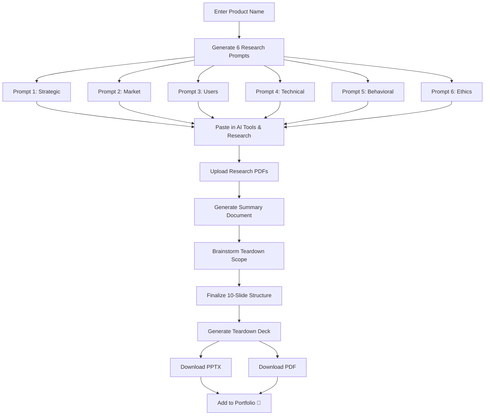

# 🔬 Product Discovery & Teardown — Project Plan (v2)

## Overview

A web application + skill system that helps a Product Manager perform **structured deep research** on any app/product, generate **targeted AI prompts** across multiple research lenses, and ultimately produce a **polished teardown document** for their portfolio.

### Core Workflow
```
Input Product Name → Generate Prompts (6 pillars) → Copy & Research in AI Tools
→ Upload Research PDFs → Generate Summary Document → Brainstorm Teardown Scope
→ Generate 10-Slide Teardown Deck → Download PPTX + PDF → Add to Portfolio
```

### Legal & Ethical Guardrails
- ❌ **No intellectual property** — No proprietary code, internal docs, or trade secrets
- ❌ **No PII** — No personal identifiable information of any individual
- ❌ **No confidential data** — No leaked financials, internal memos, or NDA-covered material
- ✅ **Public information only** — All research based on publicly available sources
- ✅ **Public images only** — Screenshots from app stores, marketing sites, and public demos
- ✅ **Attribution** — Sources cited where applicable

---

## 🗂️ Research Pillars & Prompt Strategy

All research organized into **6 Pillars**, each generating its own deep-search prompt:

### Pillar 1: Strategic & Business Context
> **Prompt Name**: `Strategic Deep Dive`

| Research Lens | What We Uncover |
|---|---|
| Mission & Vision | Company's north star, founding thesis |
| Company Verticals | Which lines of business exist, where this app sits |
| Revenue Model | How this app generates money (subscriptions, ads, transactions, etc.) |
| Ecosystem | Partner integrations, platform dependencies, API economy |
| Regulatory Landscape | Compliance requirements, data privacy, industry regulations |
| Business ↔ Mission Conflict | Tension between monetization and user value |
| Unit Economics & LTV/CAC | CAC, LTV ratio, payback period, expansion revenue, NRR |
| Privacy & Data Strategy | Data minimization, consent architecture, privacy as competitive advantage |
| Product Lifecycle Stage | Where on the Ideation → Growth → Maturity → Decline curve |

### Pillar 2: Market, Competition & Go-To-Market
> **Prompt Name**: `Market & Competitive Intelligence`

| Research Lens | What We Uncover |
|---|---|
| Competitive Dynamics | Direct/indirect competitors, positioning, moats |
| Go-to-Market Strategy | Distribution channels, growth loops, acquisition |
| Market Entry | When/how they entered, beachhead market |
| Pricing Strategy | Tiers, freemium, enterprise pricing, price anchoring |
| Flywheel & Network Effects | Self-reinforcing growth loops, network effects |
| Growth Loops | Viral loops, content-led loops, paid loops (Reforge framework) |
| Switching Costs & Lock-in | Data, financial, social/relational, customization lock-in mechanics |

### Pillar 3: Users, Outcomes & Product Craft
> **Prompt Name**: `User & Product Deep Dive`

| Research Lens | What We Uncover |
|---|---|
| User Segments | Who uses this, personas, demographics |
| Actors & Roles | Different user types and their permissions/workflows |
| Pain Points | Jobs-to-be-done, frustrations addressed |
| Business → Product Outcome Mapping | How business KPIs translate to product metrics |
| Prioritized Feature Set | Core vs differentiating features |
| Key Metrics & Guardrails | North star metric, input metrics, guardrail metrics |
| Aha Moment | The moment users realize product value |
| User Life Fit | How the app fits into daily routines |
| Activation & Time-to-Value (TTV) | Steps from download to "Aha!" moment, friction audit |
| Retention Curves & Cohort Analysis | D1/D7/D30 retention, cohort flattening, churn diagnostics |
| User Journey Mapping (Multi-layer) | Stages × actions × touchpoints × cognitive states × friction |
| Trade-off Analysis & Product Debt | MVP compromises, visible tech debt, prioritization philosophy |

### Pillar 4: Technical Architecture & Design
> **Prompt Name**: `Architecture & Design Teardown`

| Research Lens | What We Uncover |
|---|---|
| System Architecture | High-level tech stack, infrastructure |
| System Design | Data flow, API design, scalability patterns |
| Measurement Infrastructure | How they track and instrument |
| Failure Modes | What can go wrong, resilience patterns |
| Design System & UX Patterns | Visual language, interaction patterns, accessibility |
| Information Architecture | Navigation, content hierarchy |
| Platform Thinking & API Strategy | Core platform vs. feature bloat, API-as-product, extensibility |
| Experimentation & A/B Testing Culture | Feature flags, progressive rollouts, data-driven iteration |
| AI/ML Integration Sophistication | Genuine AI value vs. AI-washing, personalization depth |
| Internationalization & Localization | Multi-language, cultural adaptation, RTL, localized payments |
| Accessibility (A11y) Audit | WCAG compliance, universal design, curb-cut effect |

### Pillar 5: Behavioral Psychology & Engagement
> **Prompt Name**: `Behavioral & Engagement Deep Dive`

| Research Lens | What We Uncover |
|---|---|
| Hook Model & Habit Architecture | Trigger → Action → Variable Reward → Investment (Nir Eyal) |
| Cognitive Biases in Product Design | Endowment effect, defaults, loss aversion, anchoring, social proof |
| Onboarding Psychology | Fogg Behavior Model (B=MAT), progressive disclosure, motivation design |
| Engagement Depth & Frequency | DAU/MAU stickiness, habit loops, core action frequency |

### Pillar 6: Trust, Safety & Ethics
> **Prompt Name**: `Trust, Safety & Ethics Audit`

| Research Lens | What We Uncover |
|---|---|
| Trust & Safety by Design | Abuse prevention, content moderation, safety filters, reporting |
| Dark Patterns & Ethical Design | Forced continuity, hidden fees, disguised ads, digital well-being |
| Algorithmic Fairness | ML model bias auditing, equitable outcomes |
| Data Governance | Collection scope, retention policies, transparency |

---

## 🛠️ Skills Architecture

### Prompt Generation Skills (1 per pillar)

| # | Skill Name | Pillar | Key Frameworks Used |
|---|-----------|--------|-------------------|
| 1 | `product-strategic-research` | Strategic & Business | Business Model Canvas, Porter's Value Chain, Lifecycle Analysis |
| 2 | `product-market-research` | Market & Competition | Porter's Five Forces, Reforge Growth Loops, Competitive Moats |
| 3 | `product-user-research` | Users & Product Craft | JTBD, HEART/AARRR Metrics, Outcome Mapping, Retention Analysis |
| 4 | `product-technical-research` | Architecture & Design | System Design, C4 Model, API Maturity, A11y Audit |
| 5 | `product-behavioral-research` | Behavioral Psychology | Hook Model, Fogg B=MAT, Cognitive Bias Codex |
| 6 | `product-ethics-research` | Trust, Safety & Ethics | Ethical Design Checklist, Privacy by Design, Dark Pattern Taxonomy |

### Teardown Production Skills

| # | Skill Name | Purpose |
|---|-----------|---------|
| 7 | `teardown-design-theme` | Analyze the app's design language, extract brand colors/fonts, apply to teardown deck |
| 8 | `teardown-visual-assets` | Guide downloading public screenshots/images, organize into slide-ready library |

---

## 🌐 Web Application Architecture

### Revised User Flow (5 Stages)

```
Stage 1: INPUT
┌─────────────────────────────────────────┐
│  Enter Product/App Name                 │
│  [Start Research →]                     │
└──────────────────┬──────────────────────┘
                   │
Stage 2: PROMPT GENERATION
┌──────────────────▼──────────────────────┐
│  6 Research Prompt Cards                │
│  Each with [Generate] [Copy 📋] [Edit]  │
│  ┌─────┐ ┌─────┐ ┌─────┐              │
│  │ P1  │ │ P2  │ │ P3  │              │
│  └─────┘ └─────┘ └─────┘              │
│  ┌─────┐ ┌─────┐ ┌─────┐              │
│  │ P4  │ │ P5  │ │ P6  │              │
│  └─────┘ └─────┘ └─────┘              │
└──────────────────┬──────────────────────┘
                   │
Stage 3: UPLOAD & SUMMARIZE
┌──────────────────▼──────────────────────┐
│  Upload Research PDFs (up to 6)         │
│  [Upload] [Upload] [Upload] ...         │
│                                         │
│  [Generate Summary Document →]          │
│  Preview & download full summary        │
└──────────────────┬──────────────────────┘
                   │
Stage 4: BRAINSTORM & SCOPE
┌──────────────────▼──────────────────────┐
│  Interactive Brainstorm Panel           │
│                                         │
│  Summary highlights displayed           │
│  Suggested teardown sections            │
│  [Include] [Exclude] toggles per topic  │
│  Add custom sections                    │
│  Reorder via drag & drop               │
│                                         │
│  [Finalize Scope →]                     │
└──────────────────┬──────────────────────┘
                   │
Stage 5: TEARDOWN GENERATION
┌──────────────────▼──────────────────────┐
│  10-Slide Teardown Preview              │
│  ┌──────────────────────────────┐       │
│  │  Slide 1/10  [◀] [▶]        │       │
│  │  ┌────────────────────────┐  │       │
│  │  │                        │  │       │
│  │  │    Slide Preview       │  │       │
│  │  │                        │  │       │
│  │  └────────────────────────┘  │       │
│  └──────────────────────────────┘       │
│                                         │
│  [Download PPTX] [Download PDF]         │
└─────────────────────────────────────────┘
```

### Tech Stack
- **Frontend**: HTML5 + Vanilla CSS3 + Modern JavaScript (ES Modules, zero heavy frameworks)
- **BYOK LLM Engine**: Direct client-to-API calls for 4 major providers:
  - **OpenAI**: `https://api.openai.com/v1/chat/completions` (GPT-4o, GPT-4o-mini)
  - **Google Gemini**: `https://generativelanguage.googleapis.com/v1beta/models/...:generateContent` (Gemini 2.0 Flash, Gemini 1.5 Pro)
  - **Anthropic Claude**: `https://api.anthropic.com/v1/messages` (Claude 3.5 Sonnet with direct browser header)
  - **Groq**: `https://api.groq.com/openai/v1/chat/completions` (Llama 3.3 70B, ultra-fast low latency)
- **PDF Parsing**: pdf.js (Mozilla, 100% client-side in-browser text extraction)
- **PPT Generation**: PptxGenJS (client-side PPTX synthesis)
- **PDF Export**: jsPDF + html2canvas (client-side slide-to-PDF rendering)
- **Styling**: Premium dark aesthetic, glassmorphism, fluid responsive layouts, micro-interactions

---

## 🔐 Bring Your Own Key (BYOK) Architecture

To allow zero-cost hosting, open deployment, and complete privacy:
1. **Zero Server Footprint**: The application has NO backend server. It can be hosted on GitHub Pages, Vercel, or Netlify as a static site.
2. **Local Key Storage**: API keys are saved exclusively in the user's browser `localStorage` (or session-only memory if user prefers). Keys NEVER touch any intermediate server or proxy.
3. **Multi-Provider Switcher**: Users can seamlessly switch between OpenAI, Google Gemini, Anthropic Claude, and Groq based on available quota and preferences.
4. **Key Validation & Test**: Built-in test ping to verify credentials and connectivity before initiating summary generation.
5. **No Key Required for Prompts**: Stage 1 & Stage 2 (Prompt Generation) work 100% without any API key, allowing users to copy prompts into ChatGPT/Claude web interfaces freely.
6. **Heuristic Offline Fallback**: If no key is entered during Stage 3, a rule-based extractive summary is generated so users can still preview the workflow.

---

## 📊 Teardown Deck Framework (10 Slides)

Based on McKinsey Pyramid Principle + PM Portfolio best practices.

### Design Rules
- **Max 10 slides** — Forces signal-over-noise discipline
- **Min 14pt text** — Ensures readability in all formats
- **Action Titles** — Every slide title states an insight, not just a topic
- **Public images only** — App store screenshots, marketing material, public demos
- **No IP/PII** — Zero confidential, proprietary, or personal data
- **MECE structure** — Categories don't overlap, leave no blind spots
- **Visual-first** — Annotated screenshots, diagrams, matrices over text walls

### Slide Structure

| Slide | Title Pattern | Content |
|-------|--------------|---------|
| **1** | Title & Thesis | Product name, one-line thesis, your name, date |
| **2** | Executive Summary | Core verdict, 3 key findings, strategic implication |
| **3** | Business Model & Market | Revenue model, TAM/SAM, competitive 2×2 matrix |
| **4** | User Personas & Pain Points | Primary/secondary personas, JTBD statements, core pain points |
| **5** | Onboarding & Activation | Step-by-step flow, TTV analysis, friction audit with annotated screenshots |
| **6** | Core Product & Features | Feature architecture, information architecture, annotated UI |
| **7** | Growth & Retention Engine | Growth loops diagram, retention mechanics, Hook Model analysis |
| **8** | Behavioral & Trust Analysis | Cognitive biases used, ethical design audit, trust signals |
| **9** | Critique & Opportunities | 2-3 gaps with Impact vs Effort matrix, proposed improvements |
| **10** | Strategic Recommendations | North star metric, guardrail metrics, forward-looking strategy |

---

## 📋 Implementation Phases

### Phase 1: Foundation
- [x] Project plan and architecture (v2)
- [x] Create CONTEXT.md document
- [x] Create all 8 skills with SKILL.md files
- [ ] Set up web app structure (HTML/CSS/JS) with BYOK Settings Modal

### Phase 2: Prompt Engine
- [ ] Implement all 6 pillar prompt generators
- [ ] Copy-to-clipboard and edit functionality
- [ ] Prompt preview with syntax highlighting & filter tags

### Phase 3: BYOK LLM & Research Upload
- [ ] Direct client LLM connectors (OpenAI, Gemini, Claude, Groq)
- [ ] PDF upload and parsing with pdf.js
- [ ] LLM-powered summary document generation from uploaded research
- [ ] Summary preview and download (Markdown & plain text)

### Phase 4: Brainstorm & Scope
- [ ] Interactive brainstorm panel
- [ ] Section include/exclude toggles
- [ ] Custom section addition
- [ ] Drag-and-drop reordering

### Phase 5: Teardown Generator
- [ ] 10-slide builder following McKinsey framework
- [ ] PPTX generation with PptxGenJS (14pt min text)
- [ ] PDF export
- [ ] Public image integration

### Phase 6: Polish
- [ ] Premium UI with animations
- [ ] Responsive design
- [ ] Error handling and edge cases

---

## 🎯 End-to-End Workflow


